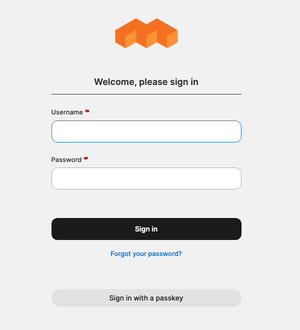
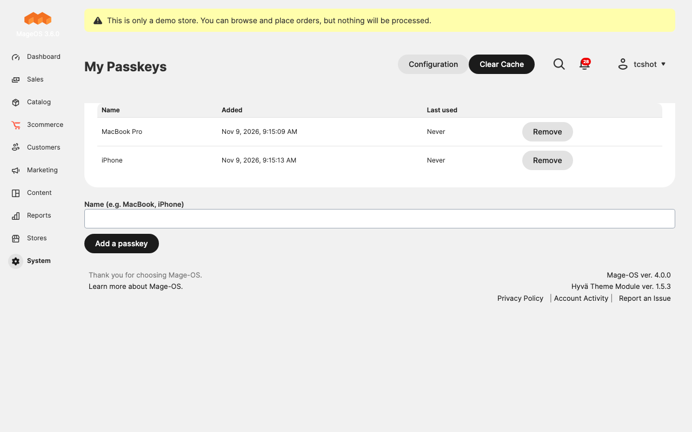
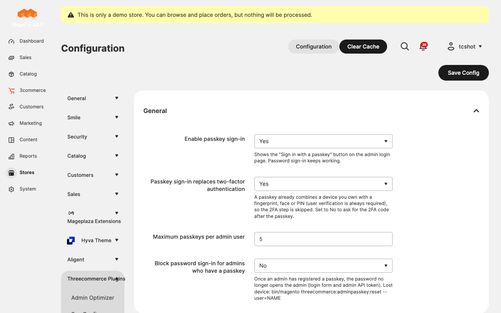

# Threecommerce_AdminPasskey: sign in to the Magento 2 / Mage-OS admin with a passkey

Adds a **passkey sign-in** to the Magento admin: Touch ID, Face ID, Windows Hello, a phone or a security key instead of the password. One button on the login page, no username to type, and the password can be closed for the admins who have a passkey.

**Compatibility:** Magento Open Source / Adobe Commerce 2.4.4 – 2.4.9 · Mage-OS 1.x / 3.x · PHP 8.2 – 8.4 · any theme (it only changes the admin)
**License:** commercial · coming soon

## Features

- **"Sign in with a passkey"** button on the admin login page. The credential is discoverable, so the browser offers your account and you do not even type the username.
- **Several passkeys per admin user** (up to a limit you set), added and removed in *System → Permissions → My Passkeys*.
- **User verification is always required** (fingerprint, face or PIN), so a passkey sign-in is already two factors. You can switch this off if you still want the 2FA code after the passkey.
- Optional **password lockout**: once an admin has a passkey, the password no longer opens the admin, neither from the login form nor from the admin API token.
- **Recovery command** if a device is lost: `bin/magento threecommerce:adminpasskey:reset --user=NAME` (or `--all`).
- Abuse protection: limited failed attempts and requests, one-time challenges that expire, and a signature counter check against cloned authenticators.
- Works with Magento's two-factor module disabled as well as enabled.

## Requirements

- Magento Open Source / Adobe Commerce 2.4.4+ or Mage-OS
- PHP 8.2 – 8.4
- **HTTPS** on the admin, and a browser with WebAuthn support (all current ones)
- Packages: `threecommerce/m2-base` and `mage-os/module-passkey-auth` (both installed automatically by Composer)

## Limitations

Passkeys are bound to the admin domain: if the admin address changes, they must be registered again, and each environment (staging, production) needs its own. With the password lockout on, keep at least two passkeys per admin (two devices) or use the recovery command. Tested with Chrome's virtual authenticator; Touch ID, Windows Hello and hardware keys depend on the browser and device.

## Availability

This module is **not yet available to buy**. It is a commercial product and is coming soon. To be notified when it is released, or to ask for details, use the [product page](https://www.threecommerce.it/admin-passkey-accesso-admin-magento-2?utm_source=github&utm_medium=readme&utm_campaign=magento2-admin-passkey) or [get in touch](https://www.threecommerce.it/contatti?utm_source=github&utm_medium=readme&utm_campaign=magento2-admin-passkey).

## Configuration

*Stores → Configuration → Threecommerce Plugins → Admin Passkey*: enable the passkey sign-in, choose whether the passkey replaces the 2FA step, the maximum number of passkeys per user and the password lockout.

## Documentation and support

- Product page: [threecommerce.it/admin-passkey-accesso-admin-magento-2](https://www.threecommerce.it/admin-passkey-accesso-admin-magento-2?utm_source=github&utm_medium=readme&utm_campaign=magento2-admin-passkey)
- [Changelog](CHANGELOG.md)
- Support and custom development: [threecommerce.it/contatti](https://www.threecommerce.it/contatti?utm_source=github&utm_medium=readme&utm_campaign=magento2-admin-passkey)

---

*This repository is the public showcase of the module. The source code is kept in a private repository.*
